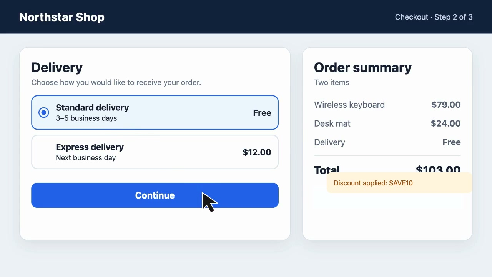
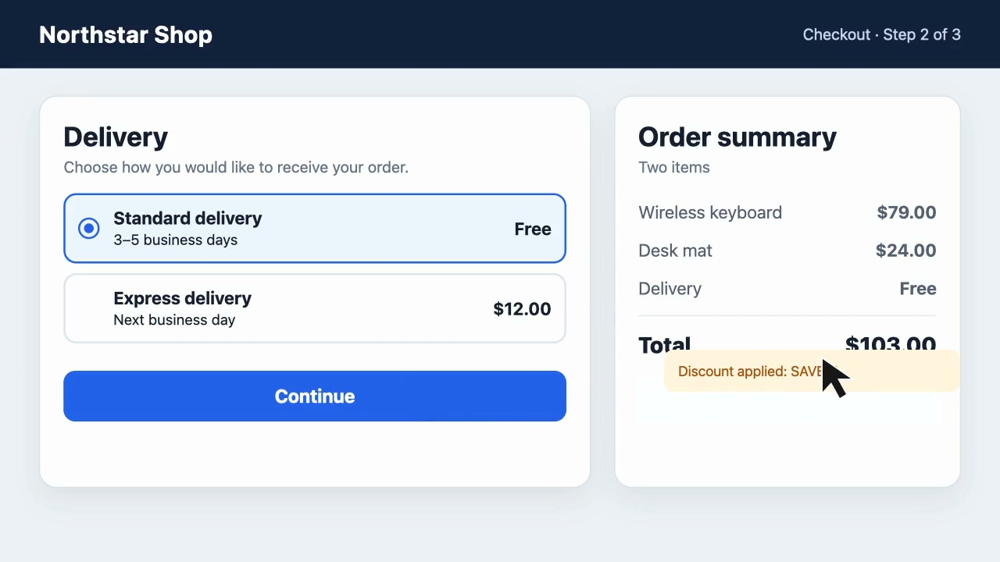

# Checkout review findings

**Source video:** [Video Findings demo](../assets/narrated-demo.mp4)

**Complete transcript:** [narrated-demo-transcript.md](narrated-demo-transcript.md)

The report below captures only the reviewer’s three spoken observations in this illustrative demo. The narrator introduces the workflow and presents the output.

## 00:07.837 — Continue gives no visible response

The reviewer selects Standard delivery and reports no response after two clicks on Continue. He expects the next step or an error explaining what needs attention.

*Evidence · 00:12.400 — Continue after the reported second attempt.*

This image locates the reported issue; one still cannot show both click attempts.

## 00:18.018 — Discount message overlaps the total

The reviewer reports that the discount message partially covers the total, making the amount awkward to read.

*Evidence · 00:20.500 — Discount message partially overlapping the Total row.*

## 00:25.274 — Item prices add up correctly

The reviewer confirms that the item prices add up: $79 + $24 = $103.

*Evidence · 00:28.000 — Item prices and the partially visible $103 total.*

## Source material

[Complete timestamped transcript](narrated-demo-transcript.md) · [VTT](narrated-demo-transcript.vtt)
